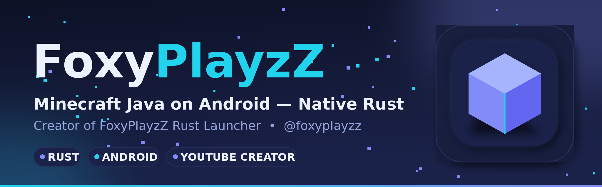

  

<h1 align="center">Hi 👋, I'm FoxyPlayzZ</h1>
<h3 align="center">🚀 I run Minecraft: Java Edition natively on Android — with a Rust engine</h3>

---

## 🧊 Featured Project — FoxyCraft Launcher

  

**Minecraft Java 26.3 on your phone — no emulator, no JVM on the device.** A native Rust/wgpu client with a Midnight Ocean UI, one-tap verified installs, built-in mods / packs / shaders catalogs and Bedrock-style touch controls with a full layout editor — new in 1.1.0, **The Touch Update**.

  
  

---

## 🙋 About Me

- 🔭 Building **FoxyCraft Launcher** — Minecraft Java Edition 26.3, native on Android
- 🎥 YouTube creator — devlogs, gameplay & updates on **[@foxyplayzz](https://youtube.com/@foxyplayzz)**
- 🦀 Rust • Android • wgpu — performance first, no bloat
- 🎮 Minecraft Java player & modder

## 🛠️ Tech & Tools

  
  
  
  
  

## 📊 GitHub Stats

  
  

## 📫 Connect With Me

  
  

